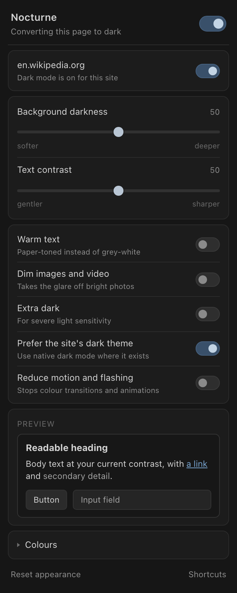

# Nocturne — Gentle Dark Mode

A Chrome extension (Manifest V3) that converts virtually any website to dark
mode, built around one priority: **not hurting to look at**. No inversion
filter, no white flashes between pages, no pure white text on pure black, and
photos, video and emoji keep their real colours.

Runs entirely locally. No backend, no analytics, no network calls except
reading stylesheets from the site you are already visiting.



---

## Install

1. Clone or download this repository.
2. Open `chrome://extensions` in Chrome.
3. Turn on **Developer mode** (top right).
4. Click **Load unpacked** and select the `nocturne-dark-mode` folder — the one
   containing `manifest.json`.
5. Dark mode is on by default. Open any site; it should already be dark.

Optional:

- Pin the moon icon to the toolbar so the popup is one click away.
- `Alt+Shift+D` toggles Nocturne everywhere, `Alt+Shift+S` toggles the current
  site. Rebind them at `chrome://extensions/shortcuts`.
- To cover local files (`file:///…`), open the extension's **Details** page and
  enable **Allow access to file URLs**.

After editing any source file, press the reload icon on the extension's card in
`chrome://extensions`, then reload the page you are testing.

---

## What the controls do

| Control | Effect |
| --- | --- |
| **Master toggle** | Turns everything off. Pages load in their original colours. |
| **Per-site toggle** | Exempts one site. Covers subdomains, and applies *before* the page loads, so a disabled site never flashes dark either. |
| **Background darkness** | Shifts the whole background ramp. `0` is a soft charcoal, `100` is close to black. `50` is the configured palette as-is. |
| **Text contrast** | Raises or lowers text lightness against the background. Lower is gentler during a migraine; higher is easier in a bright room. |
| **Warm text** | Shifts neutral text towards a warm paper tone instead of grey-white. |
| **Dim images and video** | Applies a brightness filter to `img`, `video` and `canvas` only. Off by default so media stays true to the original. |
| **Extra dark** | Deepens the background, softens text slightly, and desaturates further. For severe light sensitivity. |
| **Prefer the site's dark theme** | When a site ships its own `prefers-color-scheme: dark` theme, use that instead of a synthesised one. Usually the best-looking result. |
| **Reduce motion and flashing** | Removes transitions and animations, including colour cross-fades that can read as flicker. |
| **Colours** | Full palette override: background, surfaces, primary/secondary text, links, visited links, borders. |

Defaults follow the brief: background `#171717`, surfaces `#222222`, primary
text `#D4D4D4`, secondary text `#A3A3A3`, links a muted `#79A6D2`. Settings are
stored in `chrome.storage.local` and applied to open tabs immediately.

---

## Architecture

```
manifest.json                  permissions, popup, icons, keyboard shortcuts
src/
  core/                        shared by content script, popup and worker
    colors.js                  parsing (hex/rgb/hsl/oklch/named) + conversions
    settings.js                schema, validation, host matching, storage
    theme.js                   palette derivation, base stylesheet, transformer
  content/
    flash-guard.css            injected before first paint
    engine.js                  the transformation engine
  background/
    service-worker.js          script registration, CSS fetching, badge
  popup/                       popup.html / popup.css / popup.js
```

The three `core/` files are plain classic scripts that hang everything off a
single `NDM` global. That lets the exact same source run in three very different
places — isolated-world content script, extension page, and service worker (via
`importScripts`) — with no build step and no duplicated logic.

The transformation engine knows nothing about the UI, and the popup knows
nothing about CSS. They communicate only through `chrome.storage.local`: the
popup writes, the engine's `storage.onChanged` listener reacts. No message
passing, no state to keep in sync.

### How a page gets darkened

The engine picks one of three modes per page:

**`site-theme`** — While walking the site's stylesheets, the engine collects
everything inside `@media (prefers-color-scheme: dark)`. If that adds up to a
real theme (≥ 12 declarations), it re-emits those rules with the media
condition stripped and `!important` added. The site's own designers already
solved this page; a synthesised theme will not beat them. If the result still
renders light — some sites gate their dark rules behind a class as well — the
engine notices at `DOMContentLoaded` and falls back.

**`generic`** — Every accessible rule in every stylesheet is mirrored into an
override sheet with its colours remapped. Because the CSSOM has already expanded
shorthands into longhands, the engine only ever sees `background-color`,
`border-top-color` and friends, never `background: #fff url(hero.png)`. Each
property maps to a *role* — background, text, border, shadow — and each role has
its own lightness curve. Hue is preserved; saturation is pulled down.

The background curve is deliberately non-linear near white:

| Site colour | Becomes | Why |
| --- | --- | --- |
| `#ffffff` | `#171717` | the page background |
| `#f8f9fa` | `#1d1f22` | a subtle surface stays a subtle surface |
| `#f1f3f4` | `#242728` | …and the next tier stays distinct |
| `#cccccc` | `#353535` | |
| `#000000` | `#111111` | pure black lifted slightly — easier on the eyes |

A linear inversion would collapse the first three onto each other and flatten
the page's visual hierarchy, which is exactly how most dark-mode extensions make
sites hard to read.

**`passthrough`** — If the page is already dark, or has switched itself to its
own dark theme (`data-theme`, `data-bs-theme`, `data-color-mode` or
`data-color-scheme` set to `dark` on `<html>` or `<body>`, watched for changes
after load), the engine removes its generated sheets and keeps only `color-scheme: dark`, scrollbar styling, and any
media/motion preferences. No double-darkening.

Detection measures the page as the *site* styles it: our stylesheets are
disabled, the root background is swapped for a sentinel colour so we can tell
our own background from one the site declared, computed styles are read, and
everything is restored — all inside a single task, so the browser never gets a
chance to paint the light version.

### Preventing white flashes

This was the hardest requirement and it is handled in layers:

1. **`flash-guard.css`** is registered as a `document_start` content-script
   stylesheet. The browser applies it before the page's own CSS is parsed and
   before any script runs — the earliest point an extension can affect what gets
   painted.
2. **`engine.js` runs at `document_start`** and synchronously mounts its base
   stylesheet built from *defaults*, before `chrome.storage` has answered. The
   storage round-trip is deliberately off the critical path; real settings
   arrive a few milliseconds later and simply replace the sheet.
3. **Per-site "off" is enforced by registration, not by the engine.** The
   service worker registers the content script with `excludeMatches` for
   disabled sites, so a disabled site never receives the flash guard at all.
   Checking a setting *inside* the content script would mean painting dark first
   and reverting — a flash in the other direction.
4. **The root background is mirrored onto `<html>`** once the page settles, so
   the area below short content matches the content instead of banding against
   it.

Measured on a throttled connection, navigating from a black page to a white one:

```
without Nocturne:  frame 0 rgb(0,0,0)  →  frame 1 rgb(255,255,255)   ← flash
with Nocturne:     frame 0 rgb(0,0,0)  →  frame 1 rgb(23,23,23)      ← no flash
```

**What still cannot be fixed, and why.** Chrome paints its own surfaces before
any extension is consulted: the new-tab page, `chrome://` pages, the Web Store,
PDF viewer, Reader Mode, the browser chrome itself, and the blank frame Chrome
draws for a tab that has not committed a document yet. An extension is simply
not running at those moments. Set **Chrome → Settings → Appearance → Mode →
Dark** to cover them; that is the only fix, and it is the browser's to make.

### Dynamic content, Shadow DOM, iframes

- A single `MutationObserver` watches for added `<style>`/`<link>` elements, for
  `style`/`fill`/`stroke`/`bgcolor` attribute changes, and for subtrees that may
  contain them. Before `DOMContentLoaded` the parser emits a record for nearly
  every element, so during that window nodes are only matched, never
  subtree-scanned — walking each would be quadratic.
- Element work runs against a per-frame budget (400 elements) and yields,
  so a page with thousands of inline-styled nodes never blocks the main thread.
  Identical inline styles are deduplicated: a test page with 3 000 inline-styled
  spans produces a single CSS rule.
- Inline styles are handled with a generated sheet keyed by a `data-` attribute
  rather than by rewriting the `style` attribute, which frameworks read back.
  The one exception is an inline `!important` declaration, which outranks any
  stylesheet; those are rewritten in place, guarded against re-transform loops.
- CSS-in-JS libraries insert rules through the CSSOM without touching the DOM,
  producing no mutation record. A cheap rule-count signature is re-checked after
  mutations and on a short schedule after load.
- Open shadow roots get their own compact stylesheet — document selectors cannot
  reach into a shadow tree. Content scripts run in an isolated world, so the
  page's `attachShadow` cannot be patched; roots are discovered by walking
  instead. Closed shadow roots are unreachable by any extension.
- Sub-frames keep a transparent root background rather than a forced dark one,
  so transparent overlay iframes (ads, widgets, captchas) do not become opaque
  dark rectangles. A transparent frame over an already-dark parent is dark
  anyway.
- Cross-origin stylesheets (any CDN) throw on `cssRules` access. The content
  script asks the service worker to fetch them, which it can do with the
  extension's host permissions. Responses are cached, size-capped, time-limited,
  and fetched without credentials.

### Permissions

| Permission | Why |
| --- | --- |
| `storage` | Saving your settings. `chrome.storage.local` only. |
| `scripting` | Registering the engine at `document_start` with per-site exclusions. |
| `<all_urls>` | A dark mode extension that cannot read a page cannot darken it. Also what lets the service worker fetch a site's own CDN stylesheets. |

Deliberately **not** requested: `tabs` (host permissions already expose tab URLs),
`activeTab`, `webNavigation`, `declarativeNetRequest`, `cookies`. The extension
declares no `externally_connectable`, so no web page can send it messages.

---

## Testing it

Fixture pages for the three modes live in `test/`. Serve them and open each:

```bash
cd test && python3 -m http.server 8765
```

- `http://localhost:8765/index.html` — light page with cards, tables, forms,
  gradients, inline styles, SVG and media. Everything should be dark and
  readable; the photo, the orange circle and the emoji should be untouched.
- `http://localhost:8765/native-dark.html` — ships its own
  `prefers-color-scheme: dark` theme. The popup should say *"Using this site's
  own dark theme"*.
- `http://localhost:8765/already-dark.html` — already dark. The popup should say
  *"This page is already dark — standing by"*.
- `http://localhost:8765/dynamic.html` — Shadow DOM, an iframe, content injected
  after load, a stylesheet injected after load, and 3 000 inline-styled nodes.

Real sites worth checking, each for a different reason:

| Site | What it exercises |
| --- | --- |
| Google Search | Heavy CSS-in-JS, many inline styles, results update without navigation |
| Wikipedia | Long-form reading, tables, its own theme system |
| GitHub | Ships a real dark theme — should land in `site-theme` or `passthrough` |
| Reddit | Shadow DOM web components |
| Amazon / eBay | Legacy markup, presentation attributes, sprite images |
| A news site | Ads in cross-origin iframes, sticky headers, overlays |
| Google Docs / Sheets | Canvas rendering — a known hard case |

The popup's status line tells you which mode the engine chose, which is the
fastest way to understand what you are looking at. If a site looks wrong, turn
it off with `Alt+Shift+S` and keep browsing.

---

## Known limitations

- **Background images are not analysed.** A hero photo or a light-coloured
  texture set via `background-image` stays as it is. Deciding whether a bitmap
  is "a photo" or "a light background" needs per-image sampling, which is
  expensive and gets it wrong often enough to be worse than leaving it alone.
- **`var()` cannot be resolved statically.** The engine transforms custom
  property *declarations* instead, which covers the common
  `--surface: #fff` pattern. A variable used as both a background and a text
  colour gets one heuristic answer based on its own lightness.
- **Canvas-rendered apps** (Google Docs, Figma, charting libraries, most maps)
  draw pixels, not DOM. Nothing short of inverting the canvas touches them, and
  inverting breaks everything else in the frame.
- **Closed shadow roots** are invisible to extensions by design.
- **`prefers-color-scheme` cannot be forced.** Only the browser can change what
  that media query reports, so a site cannot be *asked* to go dark. The engine
  reads the site's dark rules and applies them directly instead, which gets the
  same result in most cases but not all.
- **Mid-tone brand colours are preserved, not darkened much.** A saturated
  mid-lightness header stays recognisably itself, desaturated. That is a
  deliberate call for visual hierarchy; turn on **Extra dark** to push further.
- **Very large stylesheets are capped** at 3 MB of generated CSS, after which
  later rules are dropped rather than risking a stall.
- **Chrome-controlled pages cannot be modified at all**: `chrome://*`, the
  new-tab page, the Web Store, `view-source:`, the PDF viewer, DevTools, other
  extensions' pages, and the interstitials Chrome shows for certificate and
  safe-browsing warnings. The popup says so when you are on one.

## Possible improvements

- Sample `background-image` bitmaps once per URL in an `OffscreenCanvas` in the
  service worker, and dim only the ones that are mostly light.
- Resolve `var()` per element through `getComputedStyle` for the elements that
  are actually on screen, using an `IntersectionObserver` to bound the cost.
- A per-site palette override, for the handful of sites worth hand-tuning.
- Scheduled profiles — a softer palette at night, a higher-contrast one by day.
- An options page listing every per-site exception, with search and bulk clear.
- Sync settings through `chrome.storage.sync` across devices, keeping the
  per-site list local so it cannot blow the sync quota.

## Development notes

`tools/make-icons.py` regenerates the icons from scratch with no dependencies
beyond the Python standard library:

```bash
python3 tools/make-icons.py
```

There is no build step. The files in `src/` are what ships.

## Licence

MIT — see [LICENSE](LICENSE).
